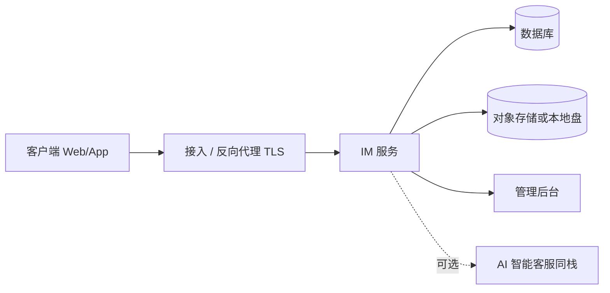

# 架构说明（说明级）

逻辑视图，便于采购与实施对齐。具体组件选型与版本以合同技术附件为准。

## 逻辑架构

## 分层说明

| 层 | 职责 |
|----|------|
| 客户端 | 会话、通讯录、文件收发 |
| 接入层 | TLS、反向代理、负载均衡 |
| IM 服务 | 消息路由、会话状态、权限 |
| 数据层 | 业务库、文件/对象存储 |
| 管理面 | 组织、角色、审计 |

## 部署形态（常见）

1. **试点**：单机或小规格云主机 + 本地或对象存储  
2. **生产**：应用与数据分离；按在线与消息峰值扩容  
3. **内网**：可在客户内网闭环部署；外连策略由客户网络与合同约定

推送、搜索、高可用拓扑等进阶项写入实施方案，不在此公开仓展开。
